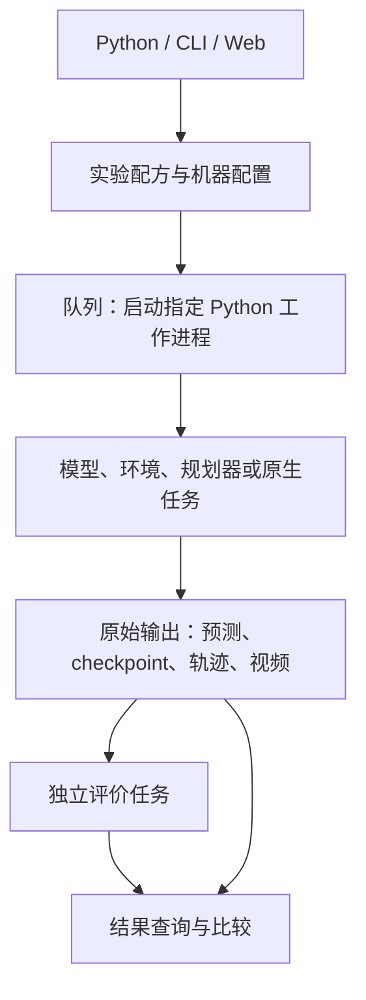

# WM-SafetyLab 项目说明：模型、任务、实现与扩展

版本：0.3.0。核对日期：2026-10-12。面向项目介绍、团队协作与研究规划。

WM-SafetyLab 是一个面向世界模型与行动安全研究的实验工作台。研究人员通过 Python、CLI 或网页提交实验，平台在指定 Python 环境中调用模型和仿真器，保存配置、日志、权重、预测、轨迹和视频，再通过独立评价任务组织结果比较。

当前已经贯通视频生成、语言与视频后果预测、机械臂状态世界模型训练、模型预测控制和反馈更新机制实验。其中，**TD-MPC2＋ManiSkill PushCube 已完成学习世界模型参与规划的真实仿真闭环**；小型状态 WM 实验则提供可直接解释为物理位置误差的预测对照。

平台当前的主要价值是让不同研究方向共用实验管理、运行入口和证据记录，同时保留各模型的原生算法与输出含义。它已经提供开展安全研究的实验基础；内容安全检测、机械臂风险指标、通用攻击与防护插件仍需逐项补齐。

## 1. 平台解决什么问题

单独部署一个模型通常比较直接；团队同时维护多个模型、仿真环境和研究方法时，还需要处理环境冲突、配置交接、实验重跑、输出保存与评价来源。平台把这些共同工作集中处理。

| 研究中的工作 | 平台目前提供的支持 | 研究人员仍需负责的部分 |
|---|---|---|
| 安装不同模型 | 每个任务选择自己的 Python 解释器与机器配置 | 安装原生依赖、准备源码、权重与资产 |
| 调用不同论文代码 | 可共享的 JSON 配方、模型适配器、原生函数入口 | 对齐输入、动作单位、控制频率和模型含义 |
| 运行训练或仿真 | 队列、超时、取消、错误记录和重跑 | 确定数据划分、训练预算与随机种子 |
| 检查实验发生了什么 | 保存实际运行配置、日志和原始工件 | 确保原生后端输出足够的研究证据 |
| 多次计算指标 | 独立评价 ID、单独输出目录、来源实验关联 | 编写符合具体任务的指标与判定规则 |
| 比较不同方法 | 网页与 API 展示指标、评价来源及差异提示 | 固定可比协议、样本分母和统计口径 |
| 多人增加组件 | 按模型、环境目录分工，提供接入模板 | 原生验收与兼容验证；接口相同不保证组合有效 |

## 2. 当前有哪些模型和环境

以下“已实跑”来自既有运行记录，不表示本次编写文档重新训练过所有模型。GitHub 包含适配代码和模板；新部署仍须准备自己的模型资源和机器配置。

### 2.1 已接入的模型及研究实例

| 模型或实例 | 输入与输出 | 当前可以完成的任务 | 已验证程度与边界 |
|---|---|---|---|
| **Wan2.1-T2V-1.3B** | 文本提示 → 视频文件 | 视频生成、生成参数对照、工件保存 | 已有真实 GPU 生成记录；内容安全评价尚需增加，视频潜变量不等于机器人控制状态 |
| **ModelScope T2V 1.7B** | 文本提示 → 视频文件 | 第二条视频生成路径、生成流程与输出对照 | 已有 Windows/Linux 原生生成记录；当前没有统一内容风险评分 |
| **DreamerV3（CartPole 工程实例）** | 记录的观测和动作 → 后验重建、未来状态预测 | 潜在状态模型预测、想象误差研究 | 使用官方 RSSM，已做 32 次训练更新的工程验证；尚不能当作收敛策略或完整 DMC 控制基线 |
| **RLVR-World language** | Bytesized32 符号状态与文本动作 → 下一状态差分、恢复状态 | 语言世界模型原生任务预测、格式与转移正确性检查 | 作者 checkpoint 已推理；既有三例精确转移评分均为 0，流程运行成功不等于预测正确；未接机械臂闭环 |
| **RLVR-World video** | RT-1 图像上下文与动作 → 后续图像 | 动作条件视觉预测、预测帧与参考帧对照 | 作者 checkpoint 和 tokenizer 已运行单样本；样本训练成员关系未核实，未完成闭环控制或全量后训练 |
| **RENEW 受控机制实例** | 2×2 2048 状态、动作、候选后果与比较反馈 → 更新后预测分布 | 比较反馈与更新目标，检查后果概率及固定阈值决策变化 | 已有真实 JAX 更新与 checkpoint；六种条件是平台定义的受控实验，不是完整 RENEW 论文复现 |
| **OpenVLA-7B** | 图像、语言指令 → 七维动作 | 原生动作推理、动作输出检查 | 已实际推理；尚未完成平台内 LIBERO/ManiSkill 任务执行，不能据此推断内部存在可调用 WM 或规划器 |
| **小型动作条件状态 WM** | 真实状态与动作 → 后续物理状态 | 采集、训练、一步/多步后果预测，与无动作模型、状态保持对照 | 已在 ManiSkill 完成 36 回合采集、3 个训练种子及留出测试；机械臂由固定规划器执行，WM 尚未参与选动作 |
| **TD-MPC2＋PushCube** | 35 维状态、8 维归一化动作 → 潜在动力学、奖励与规划动作 | 在线训练、MPPI 控制、动作扰动、固定动作预测、录像 | 已完成 102,400 次转移、12,800 次更新，以及初始/训练后/扰动三组评测；属于单训练种子的有限预算基线 |

语言、图像、物理状态、潜变量和动作输出在平台中保留各自表示。公共接口统一调用方式和工件登记，不把这些输出强行变为一个共享的“世界状态”。

### 2.2 仿真环境与教学组件

| 组件 | 用途 | 当前边界 |
|---|---|---|
| **ManiSkill 3＋Panda＋PushCube-v1** | 机械臂仿真、官方运动规划器、状态采集、录像、状态 WM 与 TD-MPC2 实验 | 主要验收任务为 PushCube；新增任务仍需确定观测、控制器和指标 |
| **Gymnasium Pendulum 教学模板** | 演示新环境的 reset/step、轨迹、录像及独立评价 | 已实际运行；恒定力矩策略是教学执行器，不是学习到的世界模型 |
| **PointEnv / LinearModel 等 CPU 示例** | 让新人验证 generate、predict、rollout、plan、native 五种调用流程 | 合成的一维环境与解析模型，不能当成科研基线 |
| **2×2 2048 任务实现** | RENEW 受控反馈更新实验的后果真值与候选空间 | 不是已经抽象为任意模型可共用的通用机械臂环境 |

默认发现的 **19 条配方**包含 5 条 CPU 示例；另有通过外部注册表加载的 5 条模型/环境教学配方。完整配方名称、参数与运行命令见[模型与实验手册](MODELS_AND_EXPERIMENTS.zh-CN.md)。

## 3. 现在能用平台完成什么工作

| 使用目标 | 当前可用组合 | 实验如何开展 | 可以得到什么 |
|---|---|---|---|
| 批次开展视频生成对照 | Wan、ModelScope | 固定提示与种子，分别提交不同参数配置 | 视频、参数和运行日志；内容是否安全需要另外评价 |
| 比较动作对未来预测的影响 | 状态 WM、TD-MPC2 | 固定初始状态和记录动作，计算多个预测时域 | 状态/潜空间误差、奖励误差及对应原始数组 |
| 研究真实机械臂后果 | 小型状态 WM＋ManiSkill | 用固定规划器采集，按回合划分数据，训练并在留出回合预测 | 方块与末端位置误差，真实/预测对照图、CSV 和视频 |
| 训练能参与选动作的 WM | TD-MPC2＋PushCube | 仿真交互进入回放缓冲区，更新官方模型，使用 MPPI 执行动作 | checkpoint、损失、真实轨迹、任务成功率与回报 |
| 比较动作扰动前后表现 | TD-MPC2 评测配方 | 固定 checkpoint 和评测种子，设置动作噪声 | 提议动作、实际执行动作、成功率与回报变化 |
| 研究反馈如何改变分布和决策 | RENEW 受控实例 | 从共同初始模型出发，应用不同反馈/更新条件，再用固定规则决策 | 概率误差、非法状态质量、接受率、决策变化及 checkpoint |
| 检查语言/视频 WM 的原生预测 | RLVR language/video | 使用各自任务格式和 checkpoint，保存预测及诊断 | 状态差分/恢复结果或预测帧；不能自动转为机械臂动作 |
| 验证 VLA 动作推理 | OpenVLA | 提交图像和指令，检查动作与推理记录 | 动作向量；任务成功率要等接入匹配仿真闭环后才能评价 |
| 重算指标、追踪结果来源 | 任意产生了所需证据的配方 | 为来源运行新增评价任务，再比较选定评价 | 独立评价记录和来源 ID，原始模型输出保留 |

这里的“批次”可由 Python 循环提交多个任务实现；当前队列顺序执行，不代表已经提供并行 GPU 调度或自动超参数搜索。

默认 Wan、ModelScope、Dreamer、RLVR、OpenVLA、RENEW 和原生 ManiSkill 配方的 `metrics=[]`。它们可能有原生诊断或研究报告，但不会自动获得平台的独立安全分数。小型状态 WM、TD-MPC2 及部分教学配方已配置独立指标。

训练能力也按实例提供：小型状态 WM 有监督训练入口，TD-MPC2 有在线训练入口，RENEW 有受控反馈更新入口；Dreamer 有独立的离线工程训练脚本。当前没有 Wan、ModelScope、OpenVLA 的微调配方，也没有 RLVR-World 的完整后训练管线。TD-MPC2 支持从已有模型权重继续初始化训练，但当前 checkpoint 不包含优化器、经验回放和随机数状态，不能当作精确断点恢复。

### 三条代表性流程

**物理后果预测：**固定规划器驱动 Panda → 采集状态和动作 → 按回合划分训练/验证/测试 → 训练动作条件和无动作状态模型 → 比较一步/五步预测与真实方块、末端位置 → 独立评分及视频展示。这条链路用于解释预测误差，尚未让 WM 改变执行器决策。

**学习模型参与控制：**TD-MPC2 从状态编码得到 latent → 预测候选动作序列的后果与奖励/价值 → MPPI 选择动作 → ManiSkill 执行 → 转移进入经验回放 → 更新模型 → 保存 checkpoint → 在相同留出种子下评测初始、训练后和扰动条件。其 MPPI 是原生控制算法，不在外面重复套一层平台 CEM。

**反馈更新机制：**2048 提供真实后果分布 → 从相同初始模型产生候选 → 构造比较反馈 → 应用不同更新目标 → 读取更新后的概率分布 → 用固定阈值计算执行/暂缓。代理事件只用于机制验证；各条件的信息量也需分别核对，不能直接解释为现实机器人安全提升。

## 4. 平台如何实现这些任务

### 4.1 共同运行链

1. **配方描述一次任务。** `recipes.json` 指定入口、默认输入/参数、种子、时限和可选指标。
2. **机器文件描述在哪里运行。** `runtime` 指定 Python、源码/权重位置和设备环境变量；实际机器文件不随公共仓库发布。
3. **服务负责排队和管理进程。** 模型、仿真器、训练和评分的重依赖在 worker 中加载；API 进程处理提交、状态和查询。
4. **适配代码调用原生实现。** 转换数据形状、动作范围和时序，登记输出；原生网络、训练损失和规划方法尽量继续由上游实现承担。
5. **运行与评价分开保存。** 每次运行有自己的配置、日志和目录；评价用 `source_run` 关联来源并写入自己的目录。
6. **界面读取已有证据。** SQLite 保存运行记录，文件目录保存大工件，React 网页通过 HTTP 查询和展示。

当前使用的是 **SQLite＋文件目录＋自有 Web**，没有把 MLflow、DeepEval 或 promptfoo 作为运行的强制依赖。DeepEval 式的小型 Python 入口属于设计借鉴，不代表已直接集成它的全部指标或托管服务。

### 4.2 公共接口与原生任务

| 接口或任务 | 实际职责 | 使用示例 |
|---|---|---|
| `generate(request)` | 生成输出内容 | CPU 文件生成；真实视频也可以使用复杂原生配方 |
| `predict(request)` | 根据初始观测与条件预测后果 | TD-MPC2 通用预测、教学状态模型 |
| `act(observation, instruction)` | 产生供环境执行的动作 | TD-MPC2 原生 MPPI、固定策略 |
| `reset(seed, inputs)` / `step(action)` | 初始化仿真，执行动作，返回观测、奖励、终止等信息 | ManiSkill、Pendulum、PointEnv |
| `plan(...)` / `task=plan` | 组合预测模型、候选算法与代价函数 | 已有 Random Shooting / CEM 的 CPU 教学验证 |
| `native(config, output_dir, context)` | 封装完整训练、复杂采集或论文原生流程 | Wan、RENEW、小型状态 WM、TD-MPC2 的主配方 |
| `measure(source_result, params)` | 从已有证据计算指标 | 状态后果评价、TD-MPC2 指标 |

上表的 `native(...)` 表示函数签名约定，不要求函数一定叫 `native`。用户看到的“训练、预测、评测”等研究任务与内部 `task` 不一一对应：例如 TD-MPC2 的三个主配方，以及 Dreamer/RLVR 的兼容预测配方，均由 `task=native` 封装。

Dreamer 与 RLVR 的原生预测还使用专用的 `PredictionAdapter.predict(request, output_dir)` 及 `prediction.json` 外层记录；通用 `ModelAdapter.predict(request)` 则由 worker 调用。两种入口通过原生包装接到同一运行管理中，并没有强制改写所有模型类。

### 4.3 四层架构与综述 S1—S6 的对应

四层是研究职责划分，代码按实际功能模块组织；同一模型的一条完整实验可以跨越多层。

| 四层 | 综述阶段 | 当前承担的工作 | 主要代码落点 |
|---|---|---|---|
| **数据层** | S1 数据与观测 | 请求输入、轨迹采集、数据切分、仿真状态与动作记录 | `inputs`、环境适配器、`state_wm_maniskill/collect.py`、各资源准备工具 |
| **模型层** | S2 状态与记忆；S3 动力学与想象 | checkpoint 加载、状态编码、后验、潜在/物理/语言/图像后果预测 | `engines/<model>/` 的 adapter、backend 及官方模型实现 |
| **算法层** | S4 评估与规划 | 候选动作评价、代价函数、MPPI、采样规划、固定阈值决策规则 | `core/planners.py`、TD-MPC2 原生规划、`research/feedback_shift/decision.py` |
| **执行与反馈层** | S5 动作与控制；S6 反馈与更新 | 环境步进、动作干预、反馈生成、训练更新、独立评价与结果回看 | 环境 `step`、各 `native.py`、训练/反馈函数、`core/evaluation.py` |

配置中的 `tags` 可标记 S1—S6 及研究类别，目前是组织与解释实验的元数据，不会自动插入攻击、防护或收集某一层的内部张量。研究者要观察记忆、latent 或规划候选，仍需在相应适配器中显式导出。

### 4.4 模型与环境兼容是如何完成的

兼容层至少需要确定：观测的字段/维度、动作单位与范围、控制器类型、预测时域、回合边界及结果含义。

TD-MPC2 当前桥接的是 **35 维 ManiSkill 状态＋8 维归一化 `pd_joint_delta_pos` 动作**。另一条 `maniskill-hold` 适配使用 **28 维抽取状态＋`pd_joint_pos` 绝对关节目标**。它们虽然都使用 Panda 和 PushCube，也不能直接交换观测与动作。

同样，OpenVLA 的七维输出、RT-1 的动作编码、Bytesized32 的文本动作都需要专门的任务和控制器转换。平台不会因为模型实现了 `predict` 或 `act` 就自动完成这些匹配。

## 5. 当前如何体现世界模型安全研究

平台将“预测后果、选择动作、真实执行、反馈更新”的证据放入同一可追踪流程，使研究能够检查错误出现在什么位置、干预改变了什么，以及变化是否影响后续决策。**当前完成的是若干具体研究环节的验证，尚未覆盖完整的六阶段安全基准。**

| 安全研究类别 | 当前已有基础 | 当前没有完成的部分 |
|---|---|---|
| **非对抗失效** | 一步/多步预测误差、状态保持/无动作对照、解析错误、任务失败记录 | 全面的分布外场景、记忆长期失效、物理一致性与严重度分级 |
| **攻击** | TD-MPC2 已验证动作扰动确实施加，能够保存提议/执行动作 | 随机高斯噪声属于扰动测试；目标攻击、攻击预算、成功判据与系统红队尚未实现 |
| **防护与安全措施** | 可以编写包装组件或原生配方；RENEW 机制实验具有固定风险阈值决策规则 | 通用防护插件库、机械臂约束控制、安全停止及防护有效性评测尚未验收；动作范围裁剪不是安全保证 |
| **评测** | 独立评价、结果来源、预测误差、回报/成功率、概率与决策诊断、轨迹/视频 | 统一危险事件定义、测量覆盖率、校准风险概率及完整安全基准 |

当前 ManiSkill 任务成功与 TD-MPC2 回报反映任务完成情况。正式实验还没有提供完整的碰撞、接触力、工作空间越界等危险指标，不能以成功率代替安全率。TD-MPC2 latent MSE 没有物理坐标单位，也不能直接解释为碰撞概率。

## 6. 未来可以支持哪些任务

下表是建立在当前代码上的扩展建议，均需实现和验收后才能列为已有功能。

| 优先级 | 未来任务 | 可以复用什么 | 需要增加什么 | 完成的判据 |
|---|---|---|---|---|
| P1 | **多种子 WM 控制与扰动基准** | TD-MPC2 训练、评测、预测配方 | 多训练种子、固定扰动等级、独立任务集、统计汇总 | 在相同协议下给出性能/误差及不确定性，而非单次成功 |
| P1 | **机械臂危险事件评价** | ManiSkill 轨迹、独立指标、视频 | 碰撞对象定义、接触力/冲量单位与阈值、限位/掉落/越界判定；无法测量项保留未知 | 每个指标有能触发的案例、原始信号和测量覆盖率 |
| P1 | **防护前后配对实验** | 动作干预、checkpoint 评测与比较 | 动作前检查、任务适配的回退动作、干预记录；固定“干净/扰动 × 无防护/有防护”协议 | 同时报告风险、成功率、干预率和额外计算成本 |
| P2 | **WM 更新前后的机器人决策变化** | 状态 WM/TD-MPC2、RENEW 的机制研究经验 | 机器人反馈定义、固定规划器/决策规则、明确更新目标、父子 checkpoint 与回归数据 | 证明变化来自指定 WM 更新，并分开报告预测改善和决策改善 |
| P2 | **视觉 WM 的机械臂规划** | 视频预测工件、ManiSkill 渲染、已有规划组织方式 | 动作条件匹配、视觉编码/评价器、规划时延控制、真值对齐 | 模型预测真实参与动作选择，闭环结果优于明确对照 |
| P2 | **语言 WM 的机械臂技能级规划** | RLVR language 包装、仿真任务入口 | 对象/关系状态、技能动作词表、技能执行器及反馈；任务数据与模型适配 | 语言预测与真实技能后果有可核对对应，而非只生成一段计划文字 |
| P2 | **VLA 仿真闭环与防护** | OpenVLA 推理入口、环境接口、评价队列 | 匹配机器人和任务的权重、图像处理、动作归一化/控制频率、闭环与安全指标 | 按固定任务集报告完成率、危险事件和防护代价 |
| P2 | **视频内容与物理一致性安全评测** | Wan、ModelScope、RLVR video 的输出保存 | 两套独立指标：内容风险标注/裁判；动作条件一致性、时间一致性及物理后果参考 | 内容安全与物理/行为安全分别给出证据，不混成一个无定义总分 |
| P3 | **更多仿真任务与环境** | Env 协议、独立注册表和教学模板 | 每个环境的状态/动作桥、任务集、安全信号与录像适配 | 先通过单个真实任务，再扩大任务覆盖；相同签名不视为兼容验收 |
| P3 | **跨 Python 环境的在线模型—仿真协作** | 已有任务级环境隔离 | 持续模型进程、通信协议、批次/图像传输、超时与进程恢复 | 模型和仿真器在不同环境下完成稳定闭环，而非仅离线传文件 |
| P3 | **团队并发运行与算力扩展** | 配方、存储记录、CI | 资源调度、远程 worker、认证权限及持久化服务部署 | 并发任务不会争用同一状态或越权读取结果 |

实施时建议先扩展现有 PushCube 的安全测量与固定对照，再开展 WM 更新、防护和视觉/语言闭环；最后根据团队需要增加更多环境与调度系统。训练和后训练继续使用清晰的原生入口，暂不为所有模型强行设计同一个 `train()`。

### 未来闭环需要特别补齐的三处转换

- **视频 → 规划依据：**视频或视觉 latent 需要明确的目标/风险评价器、动作条件和时间尺度；画面生成成功不等于可用于选择机械臂动作。
- **语言 → 可执行技能：**语言中的“推到目标”等动作需要被绑定到可执行技能及其真实前置条件、后果和失败反馈。
- **VLA → 可诊断的未来预测：**已有动作输出可先用于策略闭环；若要研究内部 WM、想象或预测干预，需要该模型明确提供相应能力或另配可验证的世界模型。

## 7. 当前项目的验证与适用边界

| 证据层级 | 当前证据 | 支持什么结论 |
|---|---|---|
| 工程流程 | 干净控制环境安装、CPU 测试、Web 构建；已发布 Windows/Linux CI | 公共框架能够部署和执行已覆盖的流程 |
| 模型调用 | 视频生成、Dreamer/RLVR 预测、OpenVLA 推理等实际记录 | 对应模型、输入与环境组合可以执行 |
| 训练与仿真 | 小型状态 WM、RENEW 受控更新、TD-MPC2 训练与闭环 | 指定训练或反馈过程实际发生，产物可检查 |
| 有限预算基线 | TD-MPC2 一个训练种子，三组各十个评测种子；初始 0/10、训练后与噪声组均 10/10 最终成功 | 支持本组任务完成与干预观察，尚不支持广泛鲁棒性或安全结论 |
| 完整安全基准/论文结论 | 尚未形成跨任务、跨训练种子、危险指标完整的统一评测 | 需要明确研究假设、数据划分、风险定义、对照和统计分析 |

当前服务采用单机、单队列。同一存储目录只运行一个服务；不同任务可以选择不同 Python，但一次在线模型—环境组合仍要共用兼容环境。网页/API 没有多租户认证隔离，团队远程使用应维持当前受控连接方式。

模型、数据与场景可以逐项增加；**是否能够共同实验，要按“具体 checkpoint × 任务 × 观测/动作表示 × 控制器 × 运行环境 × 评价协议”验收**，不能只凭模型名称做保证。

## 8. 阅读与使用入口

| 读者目标 | 下一步 |
|---|---|
| 了解平台并向团队介绍 | 本说明；[项目首页](../README.md) |
| 在新机器安装并完成第一次实验 | [部署与日常使用](DEPLOYMENT_AND_USAGE.zh-CN.md) |
| 选择具体模型、填写参数、运行实验 | [模型与实验手册](MODELS_AND_EXPERIMENTS.zh-CN.md) |
| 开发模型或仿真适配器 | [接入总指南](ONBOARDING_MODELS_AND_ENVIRONMENTS.zh-CN.md)、[接口手册](DEVELOPMENT.zh-CN.md) |
| 复用目前最完整的 WM 控制基线 | [TD-MPC2 接入教程](TD_MPC2_PUSHCUBE_GUIDE.zh-CN.md)、[验收报告](TD_MPC2_PUSHCUBE_ACCEPTANCE_20261012.zh-CN.md) |
| 阅读真实状态后果与视觉对照实验 | [状态 WM 实验](STATE_WM_MANISKILL_EXPERIMENT_20261010.zh-CN.md)、[录像与预测对照](STATE_WM_MANISKILL_VIDEO_20261011.zh-CN.md) |

本文是能力与实现说明。实际安装命令和参数以对应使用手册为准；未来任务表是规划建议，不是已实现能力清单。
