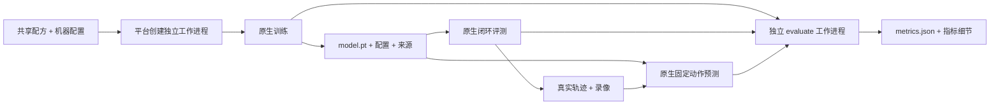

# TD-MPC2 + ManiSkill PushCube 中文开发教程

发布说明：本文的 `K:/world-model` 与 `/srv/world-model` 均为目录示例，需按机器调整。`results/`、`data-linux/`、`source-audit/` 和历史部署文档属于本地记录，未随仓库发布；文中的运行 ID、验收数值描述当时实测，不能据此假定新部署已有这些工件。

更新：2026-10-12。本文按当前 `src/wms/engines/tdmpc2/` 和 `native/tdmpc2/` 实现编写。**正式平台工程验收已通过：真实训练完成 102,400 次交互、12,800 次更新；初始/训练后/动作扰动三组各 10 个留出种子评测、固定动作预测、录像、通用接口和独立指标均已完成。** 这是单训练 seed、有限预算的工程基线，不是论文全量复现或安全性结论。具体数值、运行 ID 和边界见 [正式验收报告](TD_MPC2_PUSHCUBE_ACCEPTANCE_20261012.zh-CN.md)。本文保留可复用的开发与运行方法。

逐次部署、GPU 排障、环境安装与实际运行记录见 [公开过程记录](TD_MPC2_PROCESS_LOG.zh-CN.md)。`gpu-smoke-r4` 的 1,600 次交互/200 次更新及单回合 `checkpoint-smoke` 属于正式实验前的工程探针；正式结果单独保存在 `results/tdmpc2-integration-20261012/acceptance/acceptance.json`（本地记录，未发布），不与探针混计。

本地工程示例为 `K:/world-model/deployments/wm-safetylab`；服务器工程示例为 `/srv/world-model/deployments/wm-safetylab`。以下相对路径以对应工程根为基准。Windows 的下载、源码、环境、缓存、临时文件和结果全部留在 `K:/world-model`，运行项目前执行：

```powershell
. K:/world-model/use-k-drive.ps1
Set-Location K:/world-model/deployments/wm-safetylab
```

## 1. 先理解本次接入了什么

本次调用的是干净 ManiSkill 官方仓库中的 `examples/baselines/tdmpc2`。平台不重写 TD-MPC2 的网络、损失或 MPPI 规划器，而是在官方模型外增加机器配置、环境桥、训练循环、工件和独立指标入口。

当前准备脚本锁定官方提交 `62ff3a5896b4d5b4cf0ac4c8d79afe600c9404a3`。最终使用的 commit、上游 dirty 状态、实际安装的 ManiSkill 任务文件与 SHA-256、包版本和 GPU 信息由 `compat.provenance()` 写入本次 `provenance.json`。源码 checkout 和实际导入的 ManiSkill 包可能来自不同位置，因此两者都要记录，不能只记录 Git commit。

| 实现位置 | 负责什么 | 主要阅读入口 |
|---|---|---|
| `native/tdmpc2/recipes.json` | 共享任务名、预算、默认参数、独立指标入口 | 三个 `tdmpc2-pushcube-*` 配方 |
| `native/tdmpc2/runtime*.json` | 机器解释器、源码、资产、PhysX 库、设备及进程环境 | `runtime.linux.json`、`runtime.example.json` |
| `src/wms/engines/tdmpc2/native.py` | 平台函数入口、来源文件定位、评测和预测工件 | `train`、`policy_evaluate`、`predict` |
| `src/wms/engines/tdmpc2/backend.py` | 在线采集与更新编排、官方动作调用、动作干预 | `train`、`act`、`intervene_action` |
| `src/wms/engines/tdmpc2/compat.py` | 上游导入、官方配置、原始状态环境、replay 布局、checkpoint | `prepare`、`StateEnvironment`、`episode_to_td` |
| `src/wms/engines/tdmpc2/adapter.py` | 可选通用 `predict` / `rollout` 组件 | `ModelAdapter`、`EnvironmentAdapter` |
| `src/wms/engines/tdmpc2/metrics.py` | 标准库读取既有证据、生成独立指标 | `measure` |

**当前三个共享配方的 `task` 全部是 `native`。** `tdmpc2-pushcube-predict` 虽然名称含 predict，也使用原生函数，因为它需要读取既有评测轨迹、扫描多个回合和多个预测长度。通用 `task=predict` 是另一条可选组件路径，见第 6 节。



平台共享 core、队列和 HTTP API 不需要为 TD-MPC2 增加专用分支。模型与仿真依赖在工作进程中导入，Web 服务不需要导入 Torch 或 ManiSkill。

## 2. 状态、动作和时间必须一致

`StateEnvironment` 固定创建 `PushCube-v1`、Panda、`obs_mode="state"`、`control_mode="pd_joint_delta_pos"`、`reward_mode="normalized_dense"`、`sim_backend="physx_cuda"`。渲染使用 GPU，录像才请求 `rgb_array`。

这里的 full state 指 ManiSkill 环境直接返回的**完整状态观测向量**。代码不再手工抽取旧实验的自定义状态表示。它仍是特权仿真观测，不能等同于视觉输入，也不能据此宣称完整掌握仿真器所有隐变量。维度从实际 `observation_space` 读取并写入 `cfg.obs_shape`，加载模型后要求布局一致。

动作是 `pd_joint_delta_pos` 控制器的归一化命令，分量须有限且位于 `[-1, 1]`。这些值不是绝对关节角，也不应直接标为 rad；控制器负责将归一化命令映射到关节增量和夹爪控制。具体动作维度从环境读取并保存在 checkpoint，使用者不应绕过它写死维度。

旧 `state_wm_maniskill` 实验使用固定官方运动规划器、自定义状态和 `pd_joint_pos` 绝对关节目标。它可作为平台工件、录像对齐和只读评价的参考，不能直接将旧轨迹塞进这个模型，也不能将其表现作为同预算的 TD-MPC2 对照。

当前环境以 **50 个控制步为一个完整回合**，显式 reset，没有自动 reset。成功信号不会提前结束采集或评测，报告会写 `success_termination_ignored: true`。因此要区分“回合内曾成功”与“第 50 步仍成功”；比较实验时必须保留这一协议。视频保存 reset 后初始帧和每步之后的一帧，正常完整回合预期为 51 帧，实际还需解码核验。

状态、动作、奖励的约定为：

```text
observations: [T+1, N, O]
actions:      [T,   N, A]
rewards:      [T,   N]

s_t --实际执行 a_t--> s_(t+1), r_t
```

`episode_to_td()` 转成官方 Buffer 要求的 `[N, T+1]`。slot 0 只放初始观测，动作/奖励使用 NaN 占位；后续 slot 将 `a_t`、`r_t` 与 `s_(t+1)` 对齐，官方 sampler 会丢弃 slot 0 的动作/奖励。不要把占位 NaN 错当成真实环境数值，也不要为了消除它而把动作移错一步。

## 3. 怎样写原生训练入口

共享配方 `tdmpc2-pushcube-train` 指向 `wms.engines.tdmpc2.native:train`。其签名符合平台既有约定：

```python
def train(config, output_dir, context):
    runtime, params, inputs = _settings(config)
    report = train_backend(runtime, params, output_dir, context,
                           seed=int(config.get("seed", 0)),
                           checkpoint=inputs.get("checkpoint"))
    return _result(output_dir, report)
```

这段示意只呈现调用边界，完整实现见源码。`inputs` 放 checkpoint 等本次文件输入，`params` 放训练算法参数。当前入口不把两者混合；顶层 `config.steps` 也不会自动替代 `params.steps`。训练种子来自顶层 `seed`。

训练数据流如下：

1. `compat.prepare(runtime)` 加载项目指定的上游目录和 GPU 运行条件；`make_config()` 读取官方 `config.yaml`，去掉 Hydra launcher 的 defaults，应用平台允许覆盖的参数以及官方 `MODEL_SIZE` 表。
2. 建立 `StateEnvironment`，从实际环境补齐观测维度、动作维度、50 步回合长度和热身步数；实例化官方 `TDMPC2` 和 `common.buffer.Buffer`。
3. 热身阶段执行归一化随机动作。累计步数超过 `cfg.seed_steps` 后，由官方 `agent.act(..., eval_mode=False)` 采集；热身步数为 `max(1000, num_envs × 50)`。
4. 采完一整个并行回合后调用 `episode_to_td()` 并放入官方 Buffer，保留真实最终观测，然后显式 reset。
5. 调用官方 `agent.update(buffer)` 完成网络、动力学一致性、奖励、价值和策略相关更新。平台记录官方返回的 loss，不替换它的计算公式；MPPI 候选采样和价值评估也继续由官方代码执行。
6. 保存初始、中间和最终模型权重，统计更新次数和初始/最终参数 L2 差，并输出 `training.json`。

`model_size=5` 是官方模型规模键，由上游 `MODEL_SIZE` 决定结构，不能理解为“训练五步”。`num_samples`、`num_elites`、`num_pi_trajs`、`iterations` 和 `horizon` 控制官方规划计算预算；改这些值应写入实际配置，不把缩小后的 smoke 预算叫作完整论文设置。

当前配方默认值为：

| 参数 | 值 | 含义 |
|---|---:|---|
| `num_envs` | 32 | 并行仿真环境数 |
| `steps` | 102400 | 所有并行环境合计的真实转移预算 |
| `buffer_size` | 102400 | replay 预算 |
| `steps_per_update` | 8 | 指定采样/更新比例 |
| `batch_size` | 256 | 官方更新 batch |
| `checkpoint_every` | 25600 | 按累计环境步数保存中间权重 |
| `timeout_s` | 14400 | 本次工作进程执行时限，不含排队 |

实现要求 `params.steps` 是 `num_envs × 50` 的整数倍，保证每条采集转移均进入完整 replay 回合；`steps_per_update` 必须整除 `num_envs`。预算过短可能只有热身，代码会拒绝将 `update_count=0` 的结果报告为已训练模型。

| 训练产物 | 内容 |
|---|---|
| `initial.pt` | 本次开始时的模型状态 |
| `checkpoint_*.pt` | 按预算保存的中间模型 |
| `model.pt` | 本次最终模型，供后续任务加载 |
| `config.resolved.json` | 展开后的实际官方/环境配置 |
| `provenance.json` | 源码 commit、实际任务文件、依赖、设备等 |
| `training_history.jsonl` | 回合边界的累计步数、采集回报/成功率、更新日志 |
| `training.json` | 最终步数、更新数、参数变化、loss、权重清单和边界 |

checkpoint 格式为 `wms.tdmpc2/1`，包含 `model`、`config`、`metadata`。它保存模型和重建所需配置，**没有保存优化器、replay 或 RNG 状态**。`inputs.checkpoint` 当前表示模型权重 warm start，会检查控制模式、状态/动作维度和模型规模；不能称为精确断点续训。

## 4. 怎样写独立闭环评测与录像入口

`tdmpc2-pushcube-eval` 调用 `native:policy_evaluate`。它重新加载一个训练 checkpoint，创建新的单环境进程，不调用 `agent.update()`。默认评测种子为 1000—1009，默认仅录制顺序中的前两个回合；可以显式给出 `inputs.seeds`，不按结果筛选成功视频。

checkpoint 可以用直接路径或平台 run ID 定位：

- `inputs.checkpoint`：目标服务器可读取的绝对路径。
- `inputs.source_run`：同一平台存储中的训练 run ID，默认读取该 run 的 `output/model.pt`。
- `inputs.source_run` 配合 `inputs.initial_checkpoint: true`：读取同一训练 run 的 `output/initial.pt`，用于比较本次训练开始时和结束时的模型。`initial.pt` 的含义是本次起点，若训练采用 warm start，它不等于随机未训练模型。

显式非空 `inputs.checkpoint` 优先于 source_run，因此 `initial_checkpoint` 只影响按 run ID 自动寻找权重的路径。这里的 source_run 是模型输入字段，不会自动变成平台独立评价的 source_run 关联；真正的独立指标关联由第 7 节的 evaluate 任务建立。

模型加载使用其保存的状态/控制配置，并把环境数设为 1；还会对真实环境输入维度进行检查。`backend.act()` 继续调用官方随机 MPPI 的 `eval_mode=True`，每个回合显式设种子。当前兼容函数仅处理官方代码对 `_prev_mean` 与 `_prev_mean_eval` 的属性存在性检查，避免加载后第二步检查不到该属性；实际 MPPI 计算仍由上游完成。

评测中的可选研究挂接点已经在数据流中：

```text
真实 obs ──观测噪声──> policy_observation ──官方 MPPI──> proposed_action
                                                        │
                                 action_scale + action_noise + clamp[-1,1]
                                                        │
                                              executed action → 仿真
```

默认 `observation_noise_std=0.0`，不扰动状态观测。可选观测噪声逐分量作用于混合单位的 privileged state，各维含义和尺度可能不同；当前只是工程扰动参数，不能解释为统一物理单位或经过校准的传感器噪声。`action_noise_std` 与 `action_scale` 作用于归一化控制命令，默认分别为 `0.0` 和 `1.0`。当前三组正式评测均保持观测噪声为零，扰动组只施加动作高斯噪声。

评测保存真实 `observations`、策略实际看到的 `policy_observations`、`proposed_actions` 和执行后的 `actions`，可以检查干预是否改变了实际命令。报告包含被改变的步数及 clipping 步数；如果以后把动作干预加入训练，必须把实际执行动作写入 replay，不能把未执行的原始提议动作配给后果。

| 评测产物 | 内容 |
|---|---|
| `evaluation.json` | checkpoint 路径/哈希、任务语义、种子、每回合 return、success_once、success_at_end、实际步数和视频名 |
| `trajectory_000.npz` 等 | T+1 个真实观测、T 个提议/执行动作、策略观测、奖励、成功标志及真实 cube/TCP XYZ |
| `episode_<seed>.mp4` | 被预先选择回合的实际仿真录像 |
| `visualization.html` | 使用相对路径的结果表与视频入口 |
| `provenance.json` | 当前评测源码/任务/依赖来源 |

`cube_xyz`、`tcp_xyz` 是 `env.oracle()` 从仿真器读出的**真实后果证据**，不是 TD-MPC2 解码出来的预测。当前没有逐步碰撞或接触力测量，任何任务成功率均不能自动变成安全率；相关报告明确写 `safety_status: not_measured`。

## 5. 怎样写固定动作的潜空间预测对照

`tdmpc2-pushcube-predict` 调用 `native:predict`。它需要同一语义下的 checkpoint 和一个已经完成的 `evaluation.json`，读取其列出的真实 `trajectory_*.npz`。入口不会重新 step 仿真器，也不会通过挑选未来观测改正递归预测。

接口输入是：

```json
{
  "recipe": "tdmpc2-pushcube-predict",
  "inputs": {
    "checkpoint": "/server/path/to/training-run/output/model.pt",
    "evaluation_report": "/server/path/to/evaluation-run/output/evaluation.json"
  },
  "params": {"horizons": [1, 5]}
}
```

上例路径是占位符，必须换成目标服务器真实文件。也可以全部使用同一平台存储中的运行 ID：

```python
config = {
    "recipe": "tdmpc2-pushcube-predict",
    "inputs": {"source_run": training_run_id, "evaluation_run": policy_run_id},
    "params": {"horizons": [1, 5]},
}
```

其中 `source_run` 定位训练 run 的 `output/model.pt`，`evaluation_run` 定位闭环评测 run 的 `output/evaluation.json`。非空显式 `checkpoint` / `evaluation_report` 路径分别优先于对应的运行 ID。入口核对控制模式、env_id、实际任务源码哈希和奖励模式，再检查 T+1/T 时间布局、状态/动作维度及数值有限性。

对每个 H 步窗口：

1. 用当前 checkpoint 的 encoder 编码初始真实观测，得到 `z_t`。
2. 将窗口内实际执行动作逐个输入官方 `model.reward(z,a)` 与 `model.next(z,a)`；奖励头用官方 `two_hot_inv` 转回数值。
3. 递归得到 `z_(t+H)`，不把中间真实观测反馈进这条预测链。
4. 用同一 encoder 对窗口末端真实观测编码，仅作为评价 target。
5. 对照同一起点的 latent persistence，以及同一模型使用零动作进行的 H 步滚动。零动作是**同一模型的反事实动作对照**，不是重新训练的无动作 WM；这里比较的 target 仍来自真实执行动作的轨迹，不能把它当成零动作在仿真器中实际执行后的真值。

当前输出 `latent_mse_hH`、`persistence_latent_mse_hH`、`zero_action_latent_mse_hH` 和 `reward_mae_hH`。奖励 MAE 是窗口最后一步的预测奖励与对应真实奖励之差，不能误称 H 步累计回报误差。汇总按所有有效窗口平均；当前回合统一 50 步时，同一 H 的每回合窗口数相同。

逐回合/长度保存 `latents_episode_XXX_hH.npz`，含 initial、predicted、actual、zero_action、predicted_reward、actual_reward；总说明在 `prediction_summary.json`。

本接入没有添加物理状态 decoder。latent 数值没有米、毫米或关节角坐标含义；`latent_mse` 只用于**同一 checkpoint 表示空间**内的误差对照，不能直接比较独立训练 checkpoint 的 latent 误差来排序模型，也不能解释成碰撞概率。若要研究真实位置误差，需要另行实现并验证解码头或其他有物理语义的预测目标。

## 6. 可选：接入通用 predict / rollout

原生入口适合完整训练、多回合评测和多窗口研究；如果已有应用只想请求一次预测或执行一回合，可以使用 `adapter.py` 的普通 Python 组件，不需要继承平台基类。

`ModelAdapter(config)` 懒加载 `runtime_config` 和 checkpoint。`ModelAdapter` 与 `EnvironmentAdapter` 的 config 均支持 `checkpoint` 直接路径，或 `source_run` 加可选的 `initial_checkpoint`；在平台任务中，worker 注入的 `output_dir` 用于定位同一存储目录下的来源 run：

- `predict(request)` 接收当前 `observation` 和归一化 `actions` 序列，返回 `predictions` 潜向量序列、`predicted_rewards`、`representation: tdmpc2_latent` 和 `physical_state_decoded: false`。
- `act(observation, instruction=None)` 内部调用官方 MPPI 返回一个动作，`instruction` 当前不参与模型计算；不能把它宣传成语言指令控制。
- `reset(seed)` 用于直接 Python 多回合调用，重新设定策略随机流和首步标记；通用 worker 不会自动调用这个模型钩子。
- `close()` 释放本适配器持有的模型引用。

通用单次预测的配置骨架：

```python
episode_seed = 7
config = {
    "task": "predict",
    "runtime": {"config_file": runtime_file},
    "model": {
        "entrypoint": "wms.engines.tdmpc2.adapter:ModelAdapter",
        "config": {"runtime_config": "$runtime.config_file", "checkpoint": checkpoint,
                   "seed": episode_seed},
    },
    "inputs": {"observation": full_state, "actions": normalized_actions},
    "seed": episode_seed,
    "metrics": [],
}
```

`runtime_file`、`checkpoint`、`full_state` 和 `normalized_actions` 由调用方提供；这不是可以直接执行的完整样例数据。可以把模型/环境 config 中的 `checkpoint` 替换成 `source_run`，并在需要初始权重时增加 `initial_checkpoint: True`。直接 Python 调用时若没有平台 run 目录结构，应优先给 checkpoint 绝对路径。通用 `predict` 的 request 由 `inputs`、`params` 和 seed/output_dir 合并，重名时 params 覆盖 inputs。

通用闭环 `rollout` 增加 `EnvironmentAdapter`：

```python
config.update({
    "task": "rollout",
    "steps": 50,
    "inputs": {},
    "environment": {
        "entrypoint": "wms.engines.tdmpc2.adapter:EnvironmentAdapter",
        "config": {"runtime_config": "$runtime.config_file", "checkpoint": checkpoint},
    },
})
```

该环境适配器提供 `reset(seed, inputs)`、`step(action)` 和 `close()`，将真实观测/奖励转成普通 Python 值，将 task_success 放入 events/info。它沿用固定 50 步协议，对平台返回 `terminated=False`，到预算时返回 truncated；原生 terminated 另存在 info 中。通用 worker 保存 `trajectory.json`。

**通用 rollout 必须显式使 `model.config.seed` 与顶层 `seed` 一致。** 顶层 seed 会传给环境 reset，但 worker 不会调用 `ModelAdapter.reset()`，也不会自动把它复制进模型 config。上述例子用同一个 `episode_seed` 写入两处。直接 Python 多回合使用时，应每回合调用 `model.reset(seed)` 和 `environment.reset(seed, inputs)`，恢复策略的首步状态。

模型懒加载、环境构造和 reset 的生命周期/RNG 调用顺序在通用组件与原生评测之间不同；即使种子相同，也不保证每一步动作和轨迹逐元素一致。正式方法对照应固定使用同一入口、构造顺序和随机协议；不能将“同 seed”当作两条路径完全等价的证明。

当前三条共享配方没有注册这些通用组件，可以提交完整 inline config，或为具体应用另外写自己的配方。通用 rollout 不是第 4 节多回合录像流程；也不要在 `act()` 外再套平台 CEM，把已有官方 MPPI 又规划一次。通用 predict 配上真实环境时，模型返回 latent、环境返回 full state，两者表示不同，不能套通用坐标减法计算误差。

## 7. 独立评价为什么是另一条任务

三个配方均登记 `wms.engines.tdmpc2.metrics:measure`，版本 `tdmpc2/1`。模型任务完成后，Runner 创建一个独立 `task=evaluate` 工作进程，继承可用运行环境，读取 source 的 result/metadata。指标函数只依赖标准库，不 import Torch、NumPy 或 ManiSkill。

其边界是：

```python
def measure(result, params):
    source = result["source_output_dir"]  # 既有模型运行的 output
    output = result["output_dir"]         # 新评价任务自己的 output
    # 只读 source；向 output 写 tdmpc2_metrics.json；返回扁平有限数值。
```

`measure` 优先根据 source `result.data.task` 选择文件；若只有一种支持的 metadata，则可按文件自动识别。多个 metadata 共存且来源未明确时会报错，不悄悄选错。

| 来源文件 | 独立指标 |
|---|---|
| `training.json` | 环境步数、更新数、回合数、时间、参数变化、finite_losses、最后四类 loss |
| `evaluation.json` | 回合数量、平均 return、曾成功率、最终成功率、平均步数、动作干预步数和干预率 |
| `prediction_summary.json` | 保留原预测任务的有限数值并加 `tdmpc2_` 前缀 |

闭环 return/成功率/步数按回合等权；动作干预率为总干预步数除以总实际步数。不存在的数值不会自动补零，非法 bool/NaN/缺字段会记录为指标错误。预测指标这一步是对已有 summary 的独立导入和校验，并未重新运行模型或从 NPZ 重新推理；若要作数值复算审计，应另外读取 checkpoint/轨迹进行检查。

平台在本次评价目录生成 `metrics.json`、`result.json`，TD-MPC2 函数另写 `tdmpc2_metrics.json`。来源只读是平台约定；本函数还拒绝把评价输出设在 source 之内。已有 16 项测试覆盖已知值、错误输入、重复评价和源文件 SHA-256 不变性，结果见 `results/tdmpc2-integration-20261012/metrics-tests/results.xml`。

检查运行时必须分别等待模型 run 和独立评价 run。模型 `completed` 不代表指标全部成功，应查看评价 `metric_errors` 是否为空。调用 `wms.evaluate(source_id)` 会新建手动评价，不覆盖原来源或自动评价。

## 8. 机器环境：overlay 的用途和限制

服务器准备脚本为 `native/tdmpc2/prepare_server.sh`。它从自身位置确定工程目录，从 `WMS_ROOT` 读取下载、源码、环境与缓存根目录。先准备兼容的 ManiSkill 基础环境，再执行：

```bash
export WMS_ROOT=/srv/world-model  # 按机器调整
source scripts/linux/use-linux.sh
bash native/tdmpc2/prepare_server.sh
```

默认基础环境为 `$WMS_ROOT/envs/maniskill-pushcube`；其他位置可设置 `WMS_TDMPC2_BASE`。缺少可执行的基础 Python 时脚本会在克隆和安装前明确失败。以下是 `WMS_ROOT=/srv/world-model` 时的路径示例：

| 内容 | 服务器位置 |
|---|---|
| 干净官方代码 | `/srv/world-model/repos/ManiSkill-tdmpc2-20261012` |
| TD-MPC2 overlay | `/srv/world-model/envs/tdmpc2-maniskill-20261012` |
| 已有 ManiSkill 基础环境 | `/srv/world-model/envs/maniskill-pushcube` |
| 原生机器配置 | 工程内 `native/tdmpc2/runtime.linux.json` |
| 生效依赖记录 | 工程内 `results/tdmpc2-integration-20261012/requirements-effective.lock.txt` |

准备脚本使用基础环境的 Python 建立新 venv，再在新环境 `site-packages/wms_maniskill_base.pth` 中引用基础环境的 `site-packages`，复用已有的大型 CUDA/物理仿真栈。Hydra、TorchRL、TensorDict 等补充依赖只装入 overlay，不修改基础环境。

**overlay 不是独立、可搬走的完整环境。** 它依赖基础环境仍位于原路径、兼容的 Python ABI、对应 Torch/CUDA/SAPIEN、实际 GPU 驱动和系统动态库。仅复制 overlay 或执行一次 `pip freeze` 不能保证在另一台机器重建。

若迁移，需要先记录基础环境与 overlay 各自包来源、Python/驱动版本、任务源码哈希、PhysX 库及当前生效锁文件，然后在目标机器重建一套匹配的完整依赖环境，或明确重建同样的 base + overlay 布局。对目标机单独运行 `pip check`、导入、CUDA/PhysX 初始化、真实环境 reset/step、官方更新与 checkpoint 回载。不能把当前服务器的绝对路径复制到 Windows 后当作已配置完成。

共享配方引用 `runtime.native_key="tdmpc2"` 和默认 `runtime.json`，不写死 Python。服务器通过 native-configs 映射或显式 `runtime.config_file` 选择 `runtime.linux.json`。Registry 的优先级为机器文件默认值 < 配方 < 本次请求；配方中的 `python: auto` 会盖过机器文件解释器，所以本次配方省略它。

`configured` 只表示机器 JSON 可以读取，不会检查解释器、Torch 或 GPU 是否真的可用。Registry 只自动解析标准运行字段的相对路径；`source_dir`、`asset_dir`、`physx_gpu_library` 等自定义资源使用目标机器绝对路径。

## 9. 已知 GPU 部署排障记录

下面是本服务器部署时实际遇到、随后解决的加载问题。解决后已经完成本文对应的真实训练和评测；其他机器仍需根据自身驱动和库路径检查，不能照搬故障判断。

### 9.1 PhysX GPU 库必须放在项目缓存并显式加载

SAPIEN 3.0.3 的自动下载流程可能落到用户目录 `~/.sapien`，不符合项目文件存储约定，并可能长时间等待下载。准备脚本改为显式准备 `105.1-physx-5.3.1.patch0` 的 GPU 库：

```text
/srv/world-model/cache/physx/105.1-physx-5.3.1.patch0/libPhysXGpu_64.so
```

归档位于项目 downloads，准备脚本对归档校验 SHA-256 后解压到上述 cache；机器 JSON 的 `physx_gpu_library` 指向该文件。`compat.prepare()` 在创建环境前加载 `libcuda.so.1` 和 PhysX 库，再启用 SAPIEN GPU physics，并将 imgui 配置位置也放在项目缓存。

`torch.cuda.is_available()` 为真只说明 Torch 能看到 CUDA，不能代替 PhysX GPU 系统初始化检查。定位此层问题可使用 `native/tdmpc2/diagnose_gpu.py`；该脚本只诊断库和 GPU 系统，不训练任务。

### 9.2 `libcuda.so` 命中 toolkit stub，返回 error 34

本服务器的 `/usr/local/lib/libcuda.so` 是 CUDA stub，直接加载它时 `cuInit(0)` 返回 34。系统中真实驱动库为 `/usr/lib/x86_64-linux-gnu/libcuda.so.1`。

本次采用进程私有查找目录，不替换系统文件：

```text
/srv/world-model/cache/nvidia-driver/libcuda.so
    → /usr/lib/x86_64-linux-gnu/libcuda.so.1
```

`prepare_server.sh` 默认不创建该链接；仅在确认存在这一故障后，以 `WMS_FIX_CUDA_STUB=true bash native/tdmpc2/prepare_server.sh` 显式启用。可用 `WMS_CUDA_DRIVER_LIBRARY` 指定本机真实驱动库；修复只写项目缓存，不改全局 CUDA。随后在本机 runtime 的 `env.LD_LIBRARY_PATH` 中设置 `.../cache/nvidia-driver`。必须让这个变量在启动 worker 前生效；单纯在已经加载库的 Python 进程内改字典，不保证改变已解析的驱动库。

### 9.3 Vulkan 使用本机真实存在的 NVIDIA ICD

本服务器应显式使用：

```text
VK_ICD_FILENAMES=/etc/vulkan/icd.d/nvidia_icd.json
```

此处不是 `/usr/share/vulkan/icd.d/nvidia_icd.json`。错误继承的 ICD 路径会使 GPU 渲染失败；运行配置应在 `env` 中明确设置正确值。不要因为 CUDA 张量计算成功就推断 Vulkan 渲染成功。

用于本服务器的运行环境字段示意：

```json
{
  "env": {
    "PYTHONUNBUFFERED": "1",
    "PYTHONDONTWRITEBYTECODE": "1",
    "LD_LIBRARY_PATH": "/srv/world-model/cache/nvidia-driver",
    "VK_ICD_FILENAMES": "/etc/vulkan/icd.d/nvidia_icd.json"
  }
}
```

当前 `runtime.linux.json` 已明确设置上述库路径和正确 Vulkan ICD；最终运行仍应保存生效配置。本文不修改 runtime JSON。如果直接执行诊断/探针脚本，而不是通过平台 worker，脚本不会自动应用 JSON 中全部 `env`，需先在启动 shell 设置环境：

```bash
cd /srv/world-model/deployments/wm-safetylab
source scripts/linux/use-linux.sh
export LD_LIBRARY_PATH=/srv/world-model/cache/nvidia-driver
export VK_ICD_FILENAMES=/etc/vulkan/icd.d/nvidia_icd.json
/srv/world-model/envs/tdmpc2-maniskill-20261012/bin/python \
  native/tdmpc2/diagnose_gpu.py native/tdmpc2/runtime.linux.json
```

确认库初始化后再运行 `native/tdmpc2/probe.py`，传入 runtime 文件和本轮新建 output 目录。探针使用 8 个环境、1600 转移、较小 batch/MPPI 候选数验证真实更新。本次 `gpu-smoke-r4` 已完成真实 1,600 次交互、200 次更新；`native/tdmpc2/probe_evaluate.py` 对应的 checkpoint-smoke 还验证了独立进程回载和一回合真实录像，详见 PROCESS_LOG。它们与正式 102,400 转移训练及三组对照评测分开记录，不作为正式表现成绩。

## 10. 平台提交、部署与验收顺序

本次正式验收的模型与接口运行如下，全部 `completed`：

| 实验 | 平台运行 ID | 当前证据状态 |
|---|---|---|
| 正式训练 | `run_d5fc89b69fb84542` | 102,400 次交互、12,800 次更新，模型已保存 |
| 本次初始检查点评测 | `run_9eefa45505254a41` | 10 个回合，曾成功/最终成功均为 0/10 |
| 训练后检查点评测 | `run_c1bbe3ad8f214a8e` | 10 个回合，曾成功/最终成功均为 10/10 |
| 训练后动作扰动评测 | `run_9ea6ef48e91f4787` | 10 个回合，曾成功/最终成功均为 10/10，500/500 步动作实际改变 |
| 固定动作潜空间预测 | `run_032261dca3894c71` | 一步/五步预测及两种对照已生成 |
| 通用 predict | `run_da83e6f77b034145` | 统一组件入口已真实运行 |
| 通用 rollout | `run_f3b7e259b9e645af` | 单回合 50 步真实交互完成 |

三组闭环评测固定 seeds 1000—1009、每回合 50 步。动作扰动组使用同一训练后权重和 `action_noise_std=0.1`，执行前裁剪到控制器范围并保存提议/执行动作；三组观测噪声均为零。五条自动独立指标任务均已完成且无指标错误，六段视频均已解码。观测扰动接口仍是可选挂接点，本次没有做正式观测噪声实验。

下面的客户端示意在三条配方已经注册、机器环境通过探针后才运行。路径和 run ID 从实际服务记录获取，不猜测或复制旧实验 ID。

```python
import wms

train_run = wms.run({"recipe": "tdmpc2-pushcube-train", "seed": 0})
trained = wms.wait(train_run["id"], timeout=14400)
assert trained["state"] == "completed", trained.get("error")

policy_run = wms.run({
    "recipe": "tdmpc2-pushcube-eval",
    "inputs": {"source_run": trained["id"]},
    "params": {"episodes": 10, "video_episodes": 2},
})
policy = wms.wait(policy_run["id"])
assert policy["state"] == "completed", policy.get("error")
```

默认客户端访问本机 8765。Windows 经已有隧道访问服务器时，先将 `WMS_BASE_URL` 设为 `http://127.0.0.1:18765`。Python 客户端在哪台机器运行与模型文件在哪台机器不是一回事：输入 checkpoint/evaluation_report 仍必须是服务工作进程能够读取的路径。

评测完成后，可以直接用 `inputs.source_run=trained["id"]` 和 `inputs.evaluation_run=policy["id"]` 提交第 5 节的原生预测，避免手工拼装服务器目录。可通过 `wms.evaluations(source_id)` 查来源关联的自动评价；或者用 `wms.evaluate(source_id)` 新建一次手动只读评价，并等待返回的评价 ID，再检查其 `metric_errors`。

### 10.1 使用完整客户端示例

`examples/tdmpc2/run_study.py` 已把整套流程写成普通 HTTP 客户端：训练 → 同一批种子的初始/训练后/动作扰动评测 → 对训练后轨迹作一步/五步潜空间对照 → 比较三组控制结果。它使用平台的 runtime，不要求客户端安装 CUDA、ManiSkill 或模型依赖。

Windows 通过现有服务器隧道启动一次新研究流程：

```powershell
. K:/world-model/use-k-drive.ps1
Set-Location K:/world-model/deployments/wm-safetylab
$env:WMS_BASE_URL = 'http://127.0.0.1:18765'
& ./.venv/Scripts/python.exe examples/tdmpc2/run_study.py `
  --record K:/world-model/deployments/wm-safetylab/results/tdmpc2-integration-20261012/study-new.json
```

该命令会新建训练和后续任务，不是只读状态查询。记录文件名也应为本轮新名字，避免覆盖已有客户端记录。若希望复用已经完成的训练，则使用：

```powershell
. K:/world-model/use-k-drive.ps1
Set-Location K:/world-model/deployments/wm-safetylab
$env:WMS_BASE_URL = 'http://127.0.0.1:18765'
& ./.venv/Scripts/python.exe examples/tdmpc2/run_study.py `
  --training-run run_d5fc89b69fb84542 `
  --record K:/world-model/deployments/wm-safetylab/results/tdmpc2-integration-20261012/study-reuse.json
```

上述训练 run 已 completed，可以作为复用来源。`--training-run` 会拒绝非 completed 来源；复用后仍会新建三组评测和预测，不复用或覆盖表中的评测 ID。默认不带该参数则新建训练。脚本会等待每个新模型任务及其自动指标评价，失败时停止；成功时保存 source run 记录，并打印比较结果。

当前脚本对模型任务显式调用 `wms.wait(..., timeout=14400)`，最长等待四小时；平台工作进程训练时限也由配方设为四小时，但客户端等待与服务端执行时限仍是两个独立限制。客户端等待超时不会取消服务器训练；应通过 API 查询真实状态，完成后复用原 run，避免不必要地重新提交训练。

### 10.2 服务文件同步与最终验收

新增配方的部署要点：Registry 在服务 `create_app()` 时构造，当前没有 reload API；写入新的 `native/tdmpc2/recipes.json` 不会热刷新现有网页目录。新增 engine 文件会被新 worker 读取，但新增配方仍需在空队列时重启本平台服务。暂时不能重启时，可先提交完整 inline config 验证入口。

PROCESS_LOG 已记录本次按原命令刷新服务、保留 43 条历史记录和注册三条配方；正式训练/评测随后独立完成，结果见验收报告。今后刷新服务仍需先确认没有在途任务。实际同步使用的代码/配方快照与摘要保存于本轮结果目录 `source-snapshot/` 和 `source-snapshot.sha256`；环境安装、准备脚本和刷新记录也以 PROCESS_LOG 所列路径为准。

参考历史脚本 `results/state-wm-video-20261011/deploy_patch.py` 的白名单/哈希/备份，以及 `results/core-refinement-20261010/deploy.py` 的 PID + start_ticks 校验、空队列重启和回滚逻辑；不要原样执行这些固定旧路径的脚本。当前正式服务历史入口为 `scripts/linux/serve.sh --native-configs results/server-simplified-deploy-20261010/native-configs.json`，部署前仍要读取真实 cmdline 和映射文件。

本轮只按明确文件清单同步 TD-MPC2 engine、配方、专属测试和文档；新机器配置独立写入。需要更新 native-configs 映射时，将旧映射复制到本轮新文件，保留旧项，仅追加 tdmpc2。保留既有环境、权重、数据库、历史结果和干净上游，不对整个工程执行删除式镜像同步。

本轮已完成工程验收。对新机器、改动后的代码或不同实验配置，仍应逐项复验以下条件：

1. 最终解释器真实环境 reset/step、GPU 渲染、官方模型 forward/update 均成功，保存实际日志。
2. 平台原生训练完成：正的 update_count、有限 loss、初始/最终参数有变化、真实 checkpoint 和配置来源可查。
3. 新进程从 `model.pt` 重建模型，按固定种子完成 50 步闭环评测；失败回合同样保存。
4. 视频解码确认帧数、尺寸、FPS、时长，HTTP 文件与浏览器均可读取；视觉录像和轨迹属于同一次仿真。
5. 固定动作预测只用初始观测和记录动作递归，输出保留 latent 语义；必要时独立重算 NPZ 中数值。
6. 模型 run 与独立 evaluate run 均完成、指标无错误；重复评价前后源文件哈希不变。
7. 记录实际 run ID、预算、种子、上游/任务哈希、设备、overlay 依赖和已知限制；部署前后的旧终态运行及配置保持一致。

本轮还完成了重复指标评价 `run_27add12648d2402b`：指标与先前自动评价相同，重复评价前后来源 output 的全部文件哈希不变。六段视频均解码为 51 帧、512×512；浏览器实际检查的两段视频 `readyState=4`、`error=null`、时长 2.55 秒，HTML 请求为 200、视频 Range 请求为 206。测试记录为完整本地套件 49 passed / 2 skipped，以及新增 2 项接线测试与 16 项指标测试合计 18 passed。

这些证据表示在所记录配置下完成了平台链路，不等同于充分训练、论文复现、跨机器可移植或安全提升。当前没有实现风险成本、校准安全概率或物理坐标解码；观测噪声接口没有做正式研究验证。warm start 仍不是优化器/replay/RNG 精确恢复，overlay 仍依赖基础环境。
